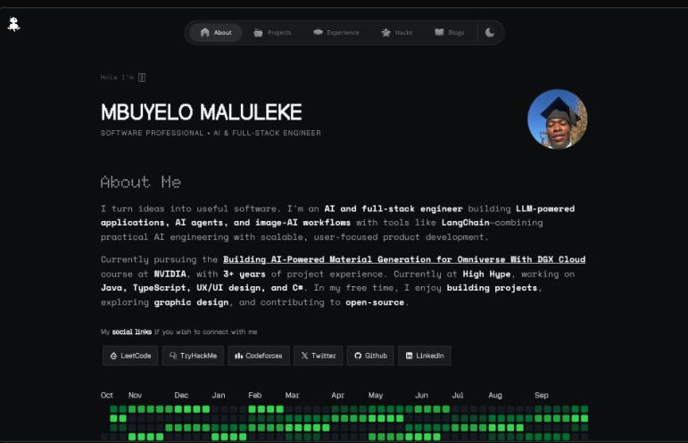

<p align="center">
  
</p>

# Mbuyelo Maluleke — AI & Full-Stack Engineer

[Visit the live portfolio](https://mbuyelollm.vercel.app/)

I build practical software across **LLM-powered applications, AI agents, image-AI workflows, and full-stack products**. My work combines AI engineering with product-focused web development, using LangChain, TypeScript, Java, and modern cloud services.

This portfolio brings together my **projects, professional experience, hackathon builds, and technical writing** in one place. It is built with Next.js, React, TypeScript, and Tailwind CSS.

I currently work across front-end design and AI development at **High Hype**, and I am continuing to deepen my skills in AI-powered product development.

## Features

### Core Pages
-   **About:** Profile, AI and full-stack engineering focus, social links, and GitHub contribution graph
-   **Projects:** Selected product and open-source work, including DeepFind.Me, Bucket0, Nimu, and OpenVScan
-   **Experience:** Timeline of professional work with responsibilities and stack
-   **Hackathons:** Competition results and project builds, including Hlokomela, an IoT water-intelligence platform that placed 4th at TCS Sustainathon South Africa 2026
-   **Blogs:** Technical articles and personal writing with reading time, table of contents, and view counts
-   **Research and Newsletter:** Dedicated pages for publications and email updates

### Blog System
-   MDX-powered articles with formatted code, headings, and links
-   Table of contents, reading time, and syntax highlighting
-   RSS feed (`/feed.xml`) and sitemap (`/sitemap.xml`)
-   View counts and newsletter features use the configured service integrations

### Additional Features
-   **Dark/Light Mode:** Theme toggling via `next-themes`
-   **Responsive UI:** Mobile-friendly layouts with animated transitions
-   **GitHub Integration:** Contribution activity, repository star counts, and profile links
-   **Contact:** Direct email link from the homepage
-   **SEO Optimized:** Full JSON-LD (Person, Website, ProfilePage, BlogPosting, Breadcrumb) plus per-page OpenGraph, Twitter cards, and canonical URLs

## Tech Stack

| Category | Technologies |
|----------|-------------|
| **Framework** | [Next.js](https://nextjs.org/) 16 (App Router, Turbopack) |
| **Language** | [TypeScript](https://www.typescriptlang.org/) 6 |
| **Runtime / Package Manager** | [Bun](https://bun.sh) |
| **Styling** | [Tailwind CSS](https://tailwindcss.com/) v4, [shadcn/ui](https://ui.shadcn.com/), [Radix UI](https://radix-ui.com/) |
| **Animation** | [Motion](https://motion.dev/) |
| **Integrations** | GitHub API, Supabase, Cloudflare R2 |
| **Content** | MDX and React |
| **Deployment** | [Vercel](https://vercel.com/) |

Featured project technologies also include **Python, FastAPI, Java, Spring Boot, LangChain, TensorFlow, Apache Kafka, and TimescaleDB**.

## Getting Started

Follow these steps to get the project running locally:

1.  **Clone the repository:**
    ```bash
    git clone https://github.com/MbuyeloMich/mbuyelomich_ai.git
    cd mbuyelomich_ai
    ```

2.  **Install dependencies:**
    ```bash
    bun install
    ```

3.  **Configure the portfolio:**
    Update identity, contact info, socials, SEO defaults, navigation, and portfolio content in [`src/site.config.ts`](src/site.config.ts).

4.  **Configure optional integrations:**
    The site can run locally without credentials. For GitHub, Supabase, analytics, or Cloudflare R2-backed features, copy `.env.example` to `.env.local` and add the relevant values.

5.  **Run the development server:**
    ```bash
    bun run dev
    ```
    Open [http://localhost:3000](http://localhost:3000) to view the site.

## Customization

Portfolio identity, contact links, social profiles, navigation, SEO defaults, experience, projects, and hackathons are configured in [`src/site.config.ts`](src/site.config.ts). Blog content lives alongside the blog routes in `src/app/blogs/`.

### Sections in `site.config.ts`

| Section | Controls |
|---------|----------|
| `identity` | Name, title, tagline, bio, rotating intros |
| `contact` | Email and portfolio URL |
| `assets` | Default OG image, blog OG image, favicon |
| `socials` | Twitter, GitHub, LinkedIn, LeetCode, TryHackMe, Codeforces |
| `seo` | Title template, default title/description, keywords, Twitter handle, theme color |
| `nav` | Navigation bar entries |
| `experiences` | Work history timeline |
| `projects` | Project showcase cards |
| `hackathons` | Hackathon entries |
| `research` | Research / publications |

### How it propagates

| Config section | Consumed by |
|----------------|-------------|
| `identity`, `seo`, `contact`, `assets` | [`src/app/layout.tsx`](src/app/layout.tsx) (root metadata, JSON-LD, theme color), [`src/lib/metadata.ts`](src/lib/metadata.ts), [`src/lib/jsonLd.ts`](src/lib/jsonLd.ts) |
| `socials` | [`src/components/sections/hero.tsx`](src/components/sections/hero.tsx) (social buttons), [`src/lib/jsonLd.ts`](src/lib/jsonLd.ts) (`sameAs`) |
| `nav` | [`src/components/sections/navigation.tsx`](src/components/sections/navigation.tsx) via [`src/constants/index.ts`](src/constants/index.ts) |
| `experiences`, `projects`, `hackathons`, `research` | Corresponding page components via [`src/constants/index.ts`](src/constants/index.ts) |
| `contact.url`, `identity.name`, `assets.ogImage` | [`src/app/feed.xml/route.ts`](src/app/feed.xml/route.ts), [`src/app/sitemap.xml/route.ts`](src/app/sitemap.xml/route.ts) |

### Adding a new page with SEO

Use the `buildMetadata` helper in [`src/lib/metadata.ts`](src/lib/metadata.ts) — it inherits all site defaults and lets you override per page:

```tsx
// src/app/your-page/page.tsx
import { buildMetadata } from "@/lib/metadata";

export const metadata = buildMetadata({
  title: "Your Page",
  description: "What this page is about.",
  path: "/your-page",
});
```

This automatically fills in canonical URL, OpenGraph tags, Twitter card, site name, and the page-appropriate image.

## Scripts

| Command | Description |
|---------|-------------|
| `bun run dev` | Start the development server |
| `bun run build` | Build for production |
| `bun run start` | Start the production server |
| `bun run lint` | Run ESLint |

## Environment Variables

All environment variables are optional for local development. Add only the values needed for the integrations you enable:

| Variables | Used for |
|-----------|----------|
| `GITHUB_TOKEN` | Authenticated GitHub API requests |
| `SUPABASE_URL`, `SUPABASE_SERVICE_ROLE_KEY` | Supabase-backed blog views and newsletter sign-ups |
| `R2_ACCESS_KEY_ID`, `R2_SECRET_ACCESS_KEY`, `R2_BUCKET_NAME`, `R2_ENDPOINT`, `R2_ACCOUNT_ID` | Cloudflare R2-backed content and asset tooling |
| `NEXT_PUBLIC_GA_ID` | Google Analytics |

For Supabase-backed features, configure the `views` table and `increment_view_count(post_slug text)` RPC, as well as the `newsletter_subscribers` table.

## Project Structure

```
src/
├── site.config.ts            # ⭐ Central config — edit this to customize
├── app/
│   ├── api/                  # API routes
│   │   ├── github/           # Contribution graph + star counts
│   │   ├── location/         # Visitor geolocation
│   │   ├── socials/          # Live social metrics
│   │   ├── subscribe/        # Newsletter subscription
│   │   ├── views/            # Blog view counter (single + batch)
│   │   └── visitors/         # Visitor tracking
│   ├── blogs/                # Blog list, [slug], MDX utilities
│   ├── experience/           # Experience page
│   ├── hackathons/           # Hackathons page
│   ├── research/             # Research page
│   ├── newsletter/           # Newsletter page
│   ├── projects/             # Projects listing
│   ├── feed.xml/             # RSS feed route
│   ├── sitemap.xml/          # Sitemap route
│   ├── layout.tsx            # Root layout (reads siteConfig)
│   ├── page.tsx              # Home page
│   └── globals.css           # Tailwind v4 theme + base styles
├── components/
│   ├── blog/                 # MDX components, view counter, TOC
│   ├── common/               # Shared (newsletter subscription, etc.)
│   ├── sections/             # Page sections (hero, projects, experience, etc.)
│   ├── layout/               # Layout wrappers and timeline
│   ├── ui/                   # shadcn/ui primitives
│   ├── icons/                # Icon components
│   └── illustrations/        # Custom SVG illustrations
├── constants/                # Re-exports content from site.config.ts
├── lib/
│   ├── metadata.ts           # buildMetadata() helper for per-page SEO
│   ├── jsonLd.ts             # JSON-LD schema generators (reads siteConfig)
│   ├── r2Client.ts           # Cloudflare R2 integration
│   ├── supabaseAdmin.ts      # Supabase server client
│   ├── github.ts             # GitHub API helpers
│   └── utils.ts              # Utility functions
├── utils/                    # Fonts and misc
└── public/                   # Static assets
```

## Connect

-   **GitHub:** [MbuyeloMich](https://github.com/MbuyeloMich)
-   **LinkedIn:** [Mbuyelo Maluleke](https://www.linkedin.com/in/mbuyelo-maluleke-72705b227/)
-   **Twitter/X:** [@tonym_43](https://x.com/tonym_43)
-   **Email:** [newtoneffect0@gmail.com](mailto:newtoneffect0@gmail.com)

## Credits

-   Original template: [ShivaBhattacharjee/Portfolio-latest](https://github.com/ShivaBhattacharjee/Portfolio-latest)

## License

This project is open source under the [MIT License](LICENSE).

## Learn More

-   [Next.js Documentation](https://nextjs.org/docs) - Learn about Next.js features and API
-   [Tailwind CSS v4](https://tailwindcss.com/docs) - Utility-first CSS framework
-   [shadcn/ui](https://ui.shadcn.com/) - Re-usable UI components
-   [Supabase](https://supabase.com/docs) - Open source Firebase alternative
-   [Cloudflare R2](https://developers.cloudflare.com/r2/) - Object storage

Built by Mbuyelo Maluleke 💙
